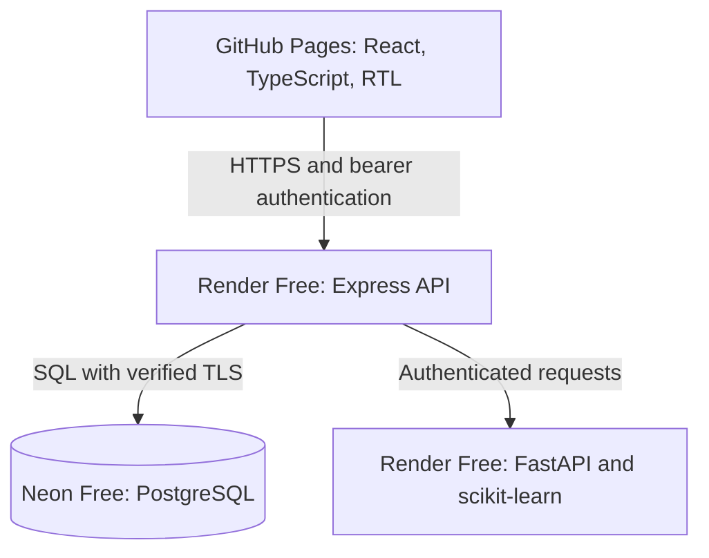
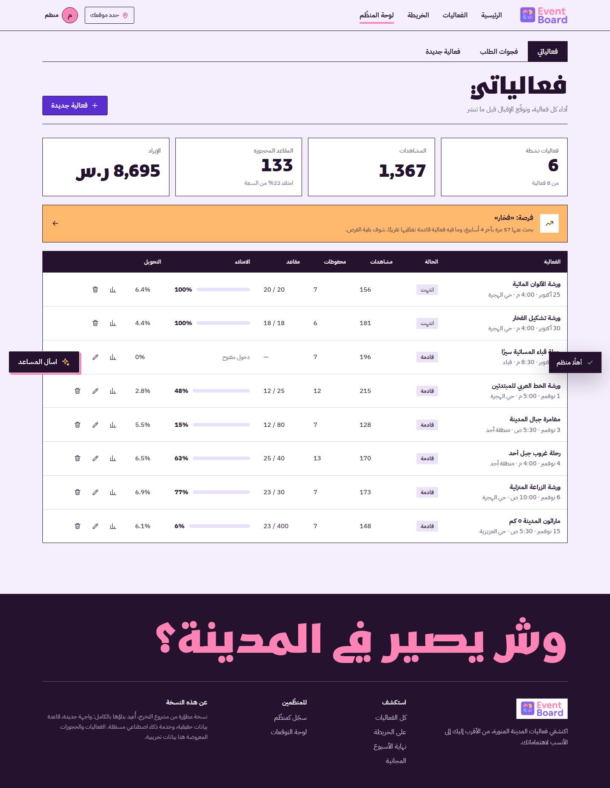

# EventBoard v2

[العربية](README.ar.md) · [AI model card](docs/ai.md) · [Visual system](docs/design.md)

**Madinah's events in one place — nearest to you, most popular, bookable, reviewed — with AI-assisted discovery and organizer analytics.**

> v2 is an independent portfolio upgrade of my 2023 Taibah University graduation project
> (the original was a static front-end). Same identity (logo, colours, Madinah video, Arabic-first
> experience); everything underneath was rebuilt as a full-stack, data-driven product.

**Public demo:** [youmnaeidh.github.io/EventBoard](https://youmnaeidh.github.io/EventBoard/) — currently v1. v2 is staged on [`release/eventboard-v2-pages`](https://github.com/youmnaeidh/EventBoard/tree/release/eventboard-v2-pages); public cutover follows verification of the hosted API and Neon database. See [release status](docs/release-status.md).

**v2 demo accounts:** `demo@eventboard.demo` (attendee) and `organizer@eventboard.demo` (organizer), password `Demo#2026`. All events, accounts, reservations and analytics are demonstration data. A demo ticket is not a real reservation or admission pass.

---

## Why this project exists

I once spent days looking for a pottery workshop in Madinah and found out a studio nearby had run one — the day before. Events start and end
without reaching the people who'd have loved them, and organizers can't see what people are asking for. EventBoard connects both sides:
attendees find the right event quickly; organizers see demand *before* they plan.

## What changed from v1 to v2

| | v1 (2023 / 2026 portfolio edition) | **v2** |
|---|---|---|
| Architecture | Static HTML/CSS/JS, browser storage, CSV | React + TypeScript SPA · Node/Express API · PostgreSQL · Python AI service |
| Data | Synthetic CSV, per-browser | Synthetic data stored in PostgreSQL, transactions, migrations, seed + refresh |
| Accounts & booking | None | Cookie/short-lived bearer sessions, roles, bookings with seat locking (no overselling), tickets with QR, reviews tied to attendance |
| Search | Keyword filters | Arabic natural-language search ("ابغى شي عائلي الليلة") that shows what it understood |
| Recommendations | Rule-based | Hybrid (content + collaborative + popularity + proximity + freshness) that **explains each recommendation** |
| Organizer tools | Report on local clicks | Attendance **forecast with a confidence interval**, best-slot advice, demand-gap analysis, per-event funnel |
| Quality | Manual | 35 API tests (real Postgres) · 27 AI tests · 5 web unit tests · 17 core + 5 Pages Playwright journeys · CI |

## Features

**For visitors** — events happening tonight/this weekend; nearest-first using GPS or a district (kept in the browser only); popularity ranking from the last
14 days of behaviour; map view; filters (category, district, price, booking); favourites; share; booking with seat stepper and QR ticket; verified reviews;
an events assistant that only answers from events that exist.

**For organizers** — create/edit events with a **live forecast panel** (expected registrations, 80% range, what drives the number, three best slots you can try
with one click); per-event analytics (funnel, daily views, sources, ratings); a **demand-gap report** (what people searched for and couldn't find — e.g. pottery).

**AI & data** — see [docs/ai.md](docs/ai.md) for algorithms, evaluation numbers and limits.

## Architecture



- The API owns all data and authentication. The AI service is **stateless**: it receives the events/behaviour it needs in each request and returns
  scores, reasons and forecasts. Users are re-indexed before the interaction matrix leaves the API; no personal data is sent.
- **If the AI service is down** the API keeps working: search falls back to keyword matching, recommendations to interests + popularity, insights to simple
  grouping; the assistant and forecast report "unavailable" instead of failing the page.
- The Render API can also serve a built web app in Docker-only mode. The target public architecture uses GitHub Pages + CORS restricted to the GitHub Pages origin with short-lived bearer authentication.

Stack: React 18, TypeScript, Vite 7, TanStack Query, React Router 7, Leaflet · Node 22.12+, Express 4, zod, `pg` (parameterised SQL), bcrypt, helmet, rate limiting ·
PostgreSQL (version 16 in CI) · Python 3.12, FastAPI, scikit-learn, NumPy/SciPy/pandas · Vitest 4 and Playwright.

## Run it

**Docker (everything):**
```bash
docker compose up --build        # http://localhost:4000  (seeds sample data on first start)
```

**Local development:**
```bash
cp .env.example .env             # then edit: DATABASE_URL, JWT_SECRET, AI_SERVICE_TOKEN
npm install
npm run migrate && npm run seed  # or just start the API: it migrates and seeds an empty database
npm run dev:api                  # http://localhost:4000
npm run dev:web                  # http://localhost:5173 (proxies /api)

cd services/ai && pip install -r requirements.txt
AI_SERVICE_TOKEN=<same as the API> python -m uvicorn app.main:app --port 8001
```
The site works without the AI service (reduced features). `ANTHROPIC_API_KEY` is optional and only changes how the assistant phrases answers.

## Tests

```bash
npm test                                  # API (needs Postgres: TEST_DATABASE_URL) + web unit tests
(cd services/ai && python -m pytest -q)   # AI service
npm run build && npm run test:e2e         # Playwright, against a running stack (see playwright.config.ts)
```
Highlights: six concurrent bookings on a 3-seat event never oversell; the API↔AI contract is tested against a stub server (including token and
circuit-breaker behaviour); e2e covers search → book → ticket → cancel, reviews, favourites, organizer create/edit/delete with the live forecast, and
overflow checks on mobile. Five additional Pages tests exercise `/EventBoard/` assets, hash-route reloads, bearer authentication without third-party cookies, favourites and bookings, and layouts at 390px and 320px. CI runs PostgreSQL and the actual Python service for browser tests.

**Verified release:** [CI run 39154465651](https://github.com/youmnaeidh/EventBoard/actions/runs/39154465651) passed all **89 tests** and both production builds. On October 19, [hosted verification 39211414937](https://github.com/youmnaeidh/EventBoard/actions/runs/39211414937) also passed **all 5 browser checks against Render and Neon**, including booking persistence, cross-origin authentication, AI forecasts and mobile layouts. The Pages source setting and public cutover remain pending.

## Screenshots

Actual Playwright captures from the passing hosted verification, using synthetic data in Neon and the Render API/AI services. The production frontend is tested at its intended browser origin before public cutover.




[View the full mobile home screenshot](docs/screenshots/home-mobile.png). Mobile layouts were checked at 390px and 320px widths.

## Deploy

`Dockerfile.api` (API only), `Dockerfile` (local web + API), `services/ai/Dockerfile`, `docker-compose.yml`, `render.yaml` and GitHub Actions workflows are included. Set `JWT_SECRET`,
`AI_SERVICE_TOKEN` and `DATABASE_URL` (+ `DATABASE_SSL=true` on Neon, which enforces certificate verification). The portfolio demo uses `AUTO_SEED=true` to initialize sample data. Use [`DEPLOYMENT.md`](DEPLOYMENT.md) for GitHub Pages, two Render Free web services and Neon Free PostgreSQL. Use Neon's **direct/non-pooled** connection string due to session-level locks in startup migrations. No expiring Render database or paid LLM key is required.

## Security & privacy notes

- Passwords hashed with bcrypt; JWT in an `httpOnly`, `SameSite=Lax` cookie for same-origin development, or an 8-hour access token held in `sessionStorage` for the cross-origin public demo; login/register rate-limited; identical error for wrong email or password.
- All SQL parameterised; inputs validated with zod; Arabic error messages; reviews limited to events that started; organizers can only touch their own events. Helmet sets response headers on the API/same-origin deployment; these headers do not apply to the separate GitHub Pages frontend.
- Behaviour tracking is limited to an anonymous random visitor id stored in the browser, used to personalise recommendations. Location is optional, rounded to ~100 m and kept in `sessionStorage`; it is sent only as query parameters on read requests.

## Known limits (said plainly)

- **All activity data is synthetic** (30 sample events, ~140 users, ~8k interactions, an 800-row forecast training set). Metrics in `docs/ai.md` describe the pipeline on that data, not real-world accuracy.
- The forecast's seasonal/weekday effects are assumptions I encoded when generating training data; swap in real bookings to retrain (`ForecastModel.fit`).
- The Claude-backed assistant path and the optional dense-embedding search are implemented and unit-tested with mocks, but were not exercised with a live API key / model weights during development.
- No offline evaluation of the recommender yet (needs real interaction data to be meaningful).
- The API and AI service are live on Render Free; Neon Free is provisioned and seeded. The public URL remains v1 until hosted browser verification and Pages cutover are complete. [Current evidence and remaining work](docs/release-status.md).
- Render Free services can sleep, causing cold-start delays. API and AI share the workspace's free usage allowance; Neon Free also has resource quotas. This demo has no uptime guarantee.
- Map tiles come from OpenStreetMap at runtime.

## Repository layout

```
apps/api        Express + TypeScript API, SQL migrations, seed data, tests
apps/web        React SPA (pages, components, hand-written SVG charts), unit tests
services/ai     FastAPI service: Arabic NLP, search, recommender, forecast, demand gaps, assistant, tests
e2e             Playwright journeys
docs            AI model card & talking points
```

## Credits

Original EventBoard concept, identity and 2023 content: Taibah University graduation project (team project; I led the team). Madinah video, logo and
event artwork are from the original project. v2 design, architecture, code and data work: Yomna Eid.


## Hosting on the original GitHub Pages URL

The v2 frontend builds for `https://youmnaeidh.github.io/EventBoard/` using HashRouter, so refreshes and deep links retain the repository base path. After cutover, `.github/workflows/deploy-pages.yml` publishes after successful CI on `main`; it checks the hosted services before deployment and the actual public website afterward. The current staging branch does not publish. See [DEPLOYMENT.md](DEPLOYMENT.md).
